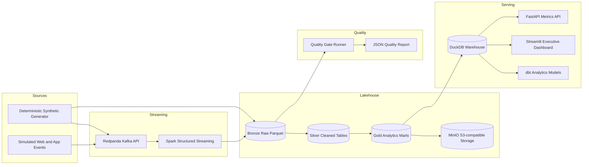

# AstraFlow Lakehouse

Production-style real-time data engineering project with synthetic data generation, streaming ingestion, lakehouse layers, data quality gates, analytics marts, API serving, dashboarding, orchestration, tests, Docker, and CI.

This repository is designed as a complete portfolio-grade data engineering platform. It uses generated commerce telemetry so the whole project can run anywhere without private datasets, paid APIs, or hidden setup.

## Why This Project Stands Out

- End-to-end system: data generation, ingestion, bronze/silver/gold lakehouse layers, validation, serving, and dashboarding.
- Realistic event domain: orders, order items, payments, shipments, inventory, clickstream, and support tickets.
- Modern stack: Python, Redpanda/Kafka, Spark Structured Streaming, DuckDB, dbt, FastAPI, Streamlit, Airflow, Docker, GitHub Actions.
- Data contracts and quality gates: required fields, uniqueness, referential integrity, numeric sanity, freshness, and quality reports.
- Cloud-ready architecture: MinIO local object storage maps directly to S3/GCS/Azure Blob patterns.
- Interview-ready documentation: architecture, data contracts, operations, scaling strategy, and tradeoffs.

## Architecture



## Tech Stack

| Layer | Technology | Purpose |
| --- | --- | --- |
| Data generation | Python standard library | Deterministic synthetic commerce data |
| Streaming bus | Redpanda | Kafka-compatible local streaming |
| Stream processing | Spark Structured Streaming | Bronze to silver streaming transforms |
| Lakehouse storage | Parquet + MinIO | Local S3-compatible data lake |
| Warehouse | DuckDB | Fast local analytical engine |
| Analytics engineering | dbt | Versioned gold metrics and docs |
| Quality | Python quality gates | Contracts, referential integrity, and reports |
| Orchestration | Airflow DAG | Daily generation, checks, and mart builds |
| Serving | FastAPI | Metrics API for downstream apps |
| Dashboard | Streamlit | Business KPI dashboard |
| DevOps | Docker Compose + GitHub Actions | Reproducible local stack and CI |

## Quickstart

```bash
git clone https://github.com/analyticsdurgesh/astraflow-lakehouse.git
cd astraflow-lakehouse

python3.11 -m venv .venv
source .venv/bin/activate
pip install -e ".[dev]"

make smoke
```

Python 3.11 is recommended for the smoothest local install. The `make smoke` command generates sample data, runs quality checks, builds the DuckDB warehouse, and runs tests.

## Run The Full Local Platform

```bash
cp .env.example .env
docker compose up -d redpanda console minio postgres

make generate
make validate
make warehouse
make api
```

Open these local services:

- FastAPI docs: http://localhost:8080/docs
- Streamlit dashboard: http://localhost:8501
- Redpanda Console: http://localhost:8085
- MinIO Console: http://localhost:9001

## Common Commands

```bash
make generate       # Generate deterministic synthetic datasets
make validate       # Run contract and quality checks
make warehouse      # Build bronze/silver/gold tables in DuckDB
make produce        # Publish generated events to Redpanda
make api            # Start FastAPI metrics service
make dashboard      # Start Streamlit dashboard
make test           # Run unit tests
make lint           # Run ruff checks
make clean          # Remove generated data, reports, and warehouse files
```

## Data Products

The project produces these gold marts:

- `gold_revenue_daily`: daily orders, revenue, average order value, and active customers.
- `gold_product_velocity`: units sold, revenue, and margin by SKU and category.
- `gold_customer_ltv`: customer order count, lifetime value, and recency.
- `gold_fulfillment_sla`: carrier delivery performance and SLA breach rate.
- `gold_marketing_attribution`: revenue and conversion by acquisition campaign.
- `gold_inventory_risk`: low stock and reorder pressure by warehouse and SKU.

## Generated Dataset

The generator creates:

- `customers.csv`
- `products.csv`
- `orders.jsonl`
- `order_items.jsonl`
- `payments.jsonl`
- `shipments.jsonl`
- `clickstream_events.jsonl`
- `inventory_snapshots.jsonl`
- `support_tickets.jsonl`
- `manifest.json`

It is deterministic by seed, which makes demos, tests, and CI reproducible.

```bash
python -m astraflow.generator --days 7 --orders-per-day 2000 --customers 12000 --products 500 --seed 42 --out data/raw
```

## Repository Structure

```text
.
├── analytics/dbt/                 # dbt project and gold SQL models
├── configs/                       # Pipeline config and quality thresholds
├── data/                          # Generated locally, ignored except sample output
├── diagrams/                      # Mermaid architecture diagrams
├── docs/                          # Architecture, contracts, operations, interview guide
├── orchestration/airflow/dags/    # Airflow DAG
├── pipelines/spark/               # Spark Structured Streaming job
├── src/astraflow/                 # Python package
├── tests/                         # Unit and contract tests
├── docker-compose.yml             # Local platform
├── Dockerfile                     # API/dashboard image
├── Makefile                       # Developer workflow
└── pyproject.toml                 # Package metadata and tooling
```

## API Examples

```bash
curl http://localhost:8080/health
curl "http://localhost:8080/metrics/revenue-daily?limit=10"
curl "http://localhost:8080/metrics/product-velocity?limit=10"
curl "http://localhost:8080/metrics/customer-ltv?limit=10"
```

## Scaling Strategy

Local mode uses DuckDB and Parquet for fast demos. A production deployment can keep the same boundaries:

- Replace local Redpanda with managed Kafka or Confluent Cloud.
- Replace MinIO with S3, GCS, or ADLS.
- Replace DuckDB serving with BigQuery, Snowflake, Databricks SQL, or Trino.
- Run Spark jobs on Kubernetes, Databricks, EMR, or DataProc.
- Promote quality gates to CI/CD and orchestration-level blocking checks.
- Add table formats such as Apache Iceberg or Delta Lake for ACID lakehouse semantics.

## Design Principles

- Generate data locally instead of relying on fragile external datasets.
- Keep raw events immutable.
- Make data contracts explicit and testable.
- Prefer small, composable commands that are easy to debug.
- Separate ingestion, transformation, validation, and serving.
- Make the project easy to explain in interviews and easy to run in CI.

## License

MIT
